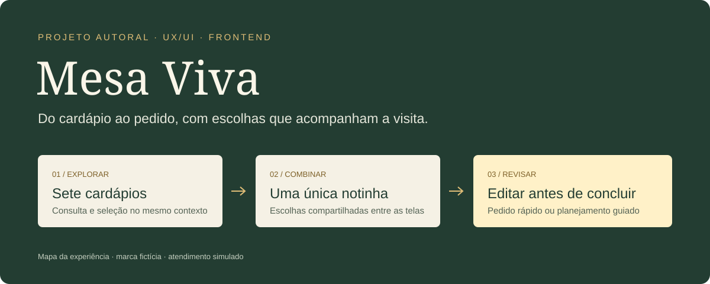
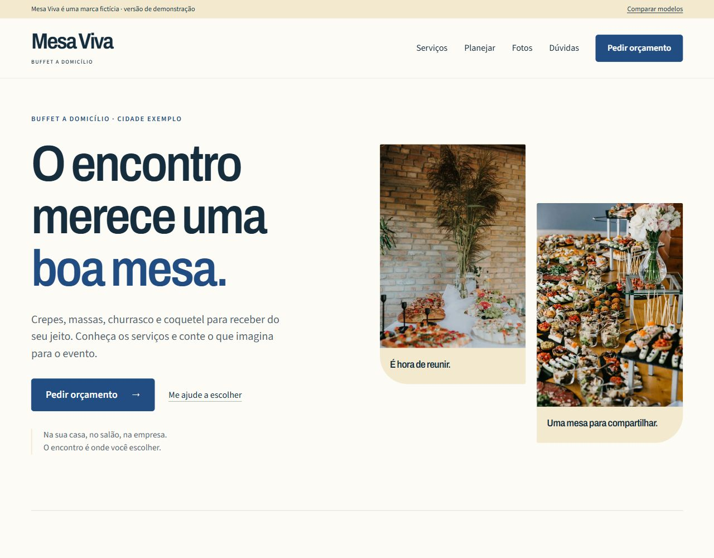

# Mesa Viva — Site interativo para buffet e eventos

Projeto autoral de frontend e UX/UI para uma marca fictícia de buffet a domicílio. A proposta é transformar a exploração de cardápios em um pedido que possa ser combinado, revisado e editado sem perder as escolhas feitas pelo caminho.



**HTML · CSS · JavaScript com módulos ES · Node.js para testes**

> Projeto demonstrativo, sem vínculo comercial com uma empresa real. O GitHub Pages foi desativado; a demonstração pode ser executada localmente. O atendimento é simulado e nenhum pedido é transmitido.

## O problema

Apresentar vários serviços pode deixar o visitante diante de um catálogo longo, escolhas desconectadas e um formulário que pede detalhes antes de ele saber o que quer. A Mesa Viva explora um percurso que mantém a consulta e o pedido conectados, com espaço para quem já decidiu e para quem ainda precisa de orientação.

## A solução

- **Cardápios no contexto:** sete modalidades em um painel, com catálogo HTML e páginas próprias como alternativas de navegação.
- **Serviços combináveis:** o visitante pode incluir mais de uma modalidade, remover escolhas e revisar a combinação.
- **Notinha do evento:** o resumo usa o mesmo estado do pedido e acompanha as alterações. Durante o formulário, o acesso fica integrado à seção para liberar os controles.
- **Dois percursos:** pedido rápido com data, convidados e local opcionais; roteiro guiado com perguntas adicionais para planejar o evento.
- **Edição protegida:** salvar confirma a alteração; cancelar mantém o valor anterior. Validação compartilhada entre o percurso, a revisão e as saídas.
- **Galeria e apresentação:** filtros, ampliação de fotos, carrossel com pausa e respeito à preferência de movimento reduzido.

## Decisões de UX/UI

| Decisão | Motivo |
|---|---|
| Um estado confirmado para o pedido | Evitar divergência entre cardápios, notinha e revisão. |
| Consulta de cardápios em painel | Permitir conhecer as opções sem abandonar a visita. |
| Percursos rápido e guiado | Ajustar o esforço ao que a pessoa já sabe sobre o evento. |
| Resumo contextual no formulário | Manter acesso às escolhas sem cobrir campos e botões. |
| Salvar e cancelar uma edição | Permitir corrigir detalhes sem perder respostas anteriores. |
| Links HTML como alternativa | Manter consulta ao conteúdo quando o JavaScript não estiver disponível; o pedido interativo depende de JavaScript. |

[Detalhes da experiência e da arquitetura](docs/estudo-de-caso.md).

## Executar localmente

Pré-requisito: Python 3 para servir os arquivos. Não há instalação de pacotes ou etapa de build.

```bash
git clone https://github.com/Ramon-BG/buffet-modelos-demo.git
cd buffet-modelos-demo
python -m http.server 8000
```

Abra **http://localhost:8000/final/** para usar a demonstração principal. A raiz local apresenta o projeto; **http://localhost:8000/historico.html** reúne os estudos anteriores. No Windows, `py -m http.server 8000` também pode ser usado quando o Python estiver disponível pelo lançador `py`.

Os módulos ES precisam ser servidos por HTTP; não abra os arquivos diretamente com `file://`.

## Testes e verificação

Com Node.js instalado:

```bash
node checks/run.mjs
# ou: npm test
```

As quatro suítes cobrem o pedido, a apresentação do resumo, os percursos e a edição/validação. O projeto também passou por conferências de navegador em telas de celular, tablet e desktop. Esses checks não substituem uma auditoria completa de acessibilidade, testes em aparelhos físicos ou avaliação com usuários.

## Organização do código

```text
final/                 Demonstração principal
  data.js              Conteúdo e modalidades
  draft.js             Estado confirmado, armazenamento e mensagem
  order-rules.js       Validação e normalização compartilhadas
  order-flow.js        Percursos e sessão temporária de edição
  conversation.js      Perguntas, controles e foco
  companion.js         Apresentação da notinha
  order-context.js     Integração do resumo com o formulário
  menu-panel.js        Consulta e escolha dos cardápios
  app.js               Integração entre as páginas e ações
checks/                Testes sem dependências externas
docs/                  Estudo de caso e imagens
historico.html         Índice dos quatro estudos anteriores
```

A separação dos módulos permite compartilhar regras sem misturar o conteúdo, o estado do pedido e a apresentação. O rascunho usa `sessionStorage` na mesma aba; quando o armazenamento está indisponível, o fluxo pode continuar em memória.

## Evolução do projeto

Quatro estudos anteriores foram preservados como referência de composição e interação, e não como planos comerciais: `economica/`, `basica/`, `intermediaria/` e `profissional/`. Os nomes das pastas permanecem para preservar o histórico e os caminhos existentes. O projeto principal está em `final/`.

<details>
<summary>Ver registro visual de uma etapa anterior</summary>



Esta captura documenta uma etapa anterior de exploração visual. A demonstração atual usa uma abertura com carrossel de fundo, paleta verde e o percurso descrito acima. Para conferir a interface atual, execute o projeto localmente.

</details>

## Limites e próximos passos

- Nome, cidade, cardápios e composições são fictícios; as fotografias são ilustrativas.
- WhatsApp e atendimento são simulados. Não há envio real, backend ou persistência em servidor.
- Não há administração, reservas, pagamentos ou integração automática com Instagram.
- Não são apresentados resultados comerciais, métricas de conversão ou depoimentos de clientes.
- Próximas validações: uso sem orientação, aparelhos físicos, desempenho e acessibilidade instrumentados.

## Créditos

Criação e desenvolvimento do projeto: [Ramon-BG](https://github.com/Ramon-BG). Fotografias e tipografias mantêm seus autores, fontes e licenças em [créditos da demonstração](final/creditos.html) e nos arquivos de licença em `final/assets/`. O mapa da experiência é uma ilustração documental, não uma captura da interface.
