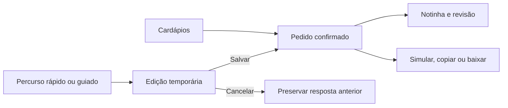

# Mesa Viva — decisões de experiência e implementação

## Contexto e escopo

Estudo autoral para uma marca fictícia de buffet. O escopo inclui apresentação, consulta a sete cardápios, galeria, preferências e preparação de um pedido simulado. A apresentação no GitHub documenta o trabalho; não representa um site contratado ou resultados de um cliente.

## Percurso principal

1. Conhecer os serviços na abertura e nas prévias de cardápios.
2. Consultar modalidades no painel e combinar serviços.
3. Conferir a notinha ou seguir diretamente para a revisão.
4. Informar detalhes opcionais no percurso rápido ou responder ao roteiro guiado.
5. Editar, salvar ou cancelar alterações antes de simular, copiar ou baixar a mensagem.

## Estado e responsabilidades

O conteúdo vive em `data.js`. O pedido confirmado é mantido por `draft.js`; validação e normalização são compartilhadas em `order-rules.js`. O percurso e sua edição temporária são organizados em `order-flow.js`. A conversa, o painel e a notinha consomem esse estado em módulos de apresentação separados.

Salvar uma edição altera somente os campos daquele contexto. Isso evita que uma mudança de serviço no painel seja apagada por uma edição de data, por exemplo. Cancelar descarta a edição temporária. Os dados de demonstração ficam na sessão da mesma aba; não há servidor de pedidos.

## Hierarquia e apresentação

A abertura usa fotografias de mesas e pratos finalizados. As prévias compactas reduzem a extensão do catálogo na inicial; o painel reúne a consulta e a seleção. A galeria fica em página própria. A notinha é recolhível fora do formulário e acessível por um resumo integrado durante o pedido.

No celular, controles se reorganizam e o conteúdo de diálogos pode rolar internamente. Navegação por foco, botões de fechamento, rótulos e preferência de movimento reduzido fazem parte da implementação, mas não constituem certificação de conformidade com WCAG.

## Evidências e limites

Os testes automatizados cobrem regras e continuidade do pedido. As conferências de navegador verificam fluxos e tamanhos específicos de tela. Não foram medidos aumento de conversão, satisfação ou desempenho em campo. Testes com pessoas sem orientação e aparelhos físicos continuam necessários.

## Evolução

Quatro estudos anteriores preservam composições diferentes. A consolidação reaproveita recursos úteis, elimina ações redundantes e mantém uma fonte de escolhas para o pedido. Os estudos não são produtos ou faixas comerciais. O registro visual em `images/evolucao-desktop.png` pertence a uma etapa anterior e está identificado dessa forma no README.
